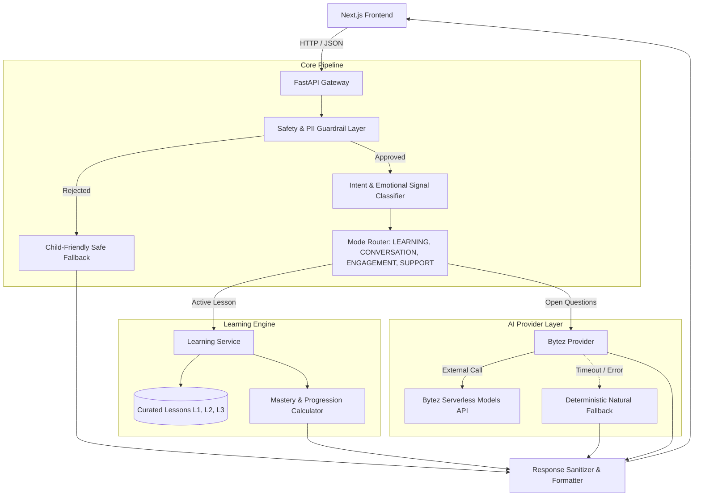

# System Architecture: BRIMSEL AI English Learning Chatbot

## Overview
The BRIMSEL English Learning Chatbot backend is a deterministic-first, child-safe conversational AI system built with FastAPI, Pydantic, and an optional Bytez LLM integration. It provides progressive English learning for children under 7 years old across Levels L1, L2, and L3.

## Architecture Diagram (Mermaid)

## Key Modules
1. **`app/api/routes.py`**: Validates request contracts (`/health`, `/api/lessons`, `/api/chat`, `/api/progress/evaluate`) with explicit Pydantic schemas.
2. **`app/core/safety.py`**: Validates input against contact information, PII, inappropriate keywords, and length limitations.
3. **`app/core/intent.py`**: Identifies intents (confusion, emotional expressions, engagement, questions) and inferred emotional signals (sad, frustrated, excited, curious).
4. **`app/services/learning_service.py`**: Evaluates learner answers, tracks mistake frequencies, determines remedial support needs, and triggers level promotions when mastery thresholds are met.
5. **`app/services/bytez_provider.py`**: Asynchronous HTTP client targeting Bytez inference endpoints with strict 5-second bounded timeouts and deterministic fallbacks.
